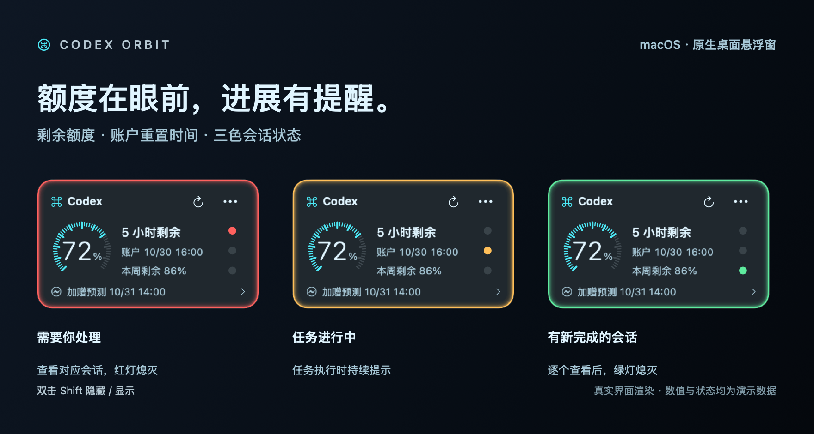

# Codex Orbit

**额度在眼前，进展有提醒。** 一个小巧的 macOS 原生透明桌面悬浮窗，随时查看 Codex 额度与本机会话状态。



> 图片由当前版本真实界面渲染，额度、时间和状态均为演示数据。图中灯带展示亮起瞬间，实际提醒约 3 秒后熄灭。

**[下载 macOS 安装包 ↓](https://github.com/zhouTF-01/codex-orbit/raw/refs/heads/main/Codex-Orbit-1.0.1-macos-arm64.zip)** · [两种安装方式](INSTALL.md) · [隐私说明](PRIVACY.md)

版本 **1.0.1** · **Apple 芯片（M 系列）Mac · macOS 26.0+** · 个人制作的非官方工具

## 安装：选一种就好

**自己安装**

1. 下载上面的 ZIP，解压后将 `Codex Orbit.app` 拖入“应用程序”。
2. 确保本机 Codex 桌面应用、Codex CLI 已安装并登录。
3. 打开 Codex Orbit，桌面出现悬浮窗即可使用。

**让自己的 Codex 安装**

把 ZIP 安装包交给 Codex，再复制 [安装手册中的完整话术](INSTALL.md)。Codex 会检查环境、安装并打开悬浮窗；详细操作与首次打开遇到系统拦截时的处理都在 [INSTALL.md](INSTALL.md)。

安装包使用临时签名，未经过 Apple 公证。当前没有应用内升级，也没有设置开机自动启动。实测环境为 macOS 26.5.1、Codex CLI 0.147.0，其他版本尚未逐一验证。

## 使用：看额度，看三盏灯

- **额度与重置时间**：显示当前窗口、本周剩余额度，后台每 60 秒更新；底部展示 WhenReset 的公开加赠预告或预测。
- **🔴 需要你处理**：有尚未查看的审批、输入或选择等人工待办。
- **🟡 正在进行**：有本机会话正在执行任务。
- **🟢 有新完成**：有已完成、尚未查看的会话。

点击圆点查看会话清单，再进入对应会话。红 / 绿灯闪约 5 秒后常亮，直到对应会话逐个查看；黄灯随任务状态熄灭。**状态变化时，整圈边框灯带独立闪约 3 秒后熄灭。** 只展开清单不会清除提醒，查看会话也不代表批准操作或回答问题。

拖动空白区域移动悬浮窗；默认 **双击 Shift 隐藏 / 显示**。右上角「⋯」可设置置顶、紧凑模式、玻璃透明度和双击快捷键。


仅监测本机根会话，不包含云主机任务和内部子 Agent。Codex 更新本地协议或数据格式后，可能需要适配。WhenReset 预测不是官方承诺，个人到账以账户额度为准。

## 源码与构建

- `Orbit.swift`：AppKit + SwiftUI 界面、额度读取和本机会话监听。
- `build.sh`：本机构建与临时签名。
- `whenreset-cache.json`：用于首次展示的公开消息缓存，按来源时间判断是否过期。
- `PRIVACY.md`：数据读取、存储及联网边界。
- `SHA256SUMS`：已封板安装包校验值。

安装 Xcode Command Line Tools 后，在仓库目录执行：

```sh
zsh build.sh
../'Codex Orbit.app'/Contents/MacOS/CodexOrbit --test
```

默认生成的 App 位于仓库上一级目录；也可以通过 `zsh build.sh /绝对路径/CodexOrbit.app` 指定输出位置。构建脚本复用当前工具链的默认部署目标；不能仅依据 Info.plist 的最低系统声明判断二进制兼容性。本仓库附带的现成安装包实际最低系统为 macOS 26.0。

已有 68 项边界与计时检查通过，覆盖多会话提醒、逐个查看、断线重连、旧读回执和快捷键检测等。物理双击修饰键未由自动化工具代按验证。

## 隐私

安装包没有附带开发者的登录凭据、会话记录或个人文件。运行时在本机读取必要会话数据，未发现上传这些数据或额外持久化的应用代码。公开消息服务仍可看到普通网络访问的 IP 等信息。详见 [PRIVACY.md](PRIVACY.md)。
